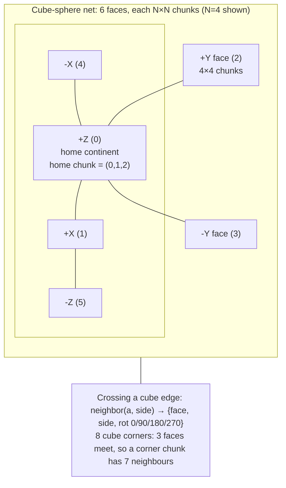
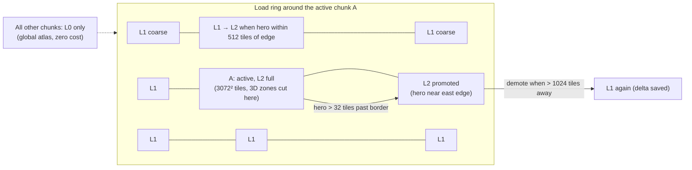

# Trailbound Planet: a world made of world-size chunks (design, not built)

Status: **decisions recorded (Nov 20, 2026); M0 + M1 built** on branch `planet-m1` (see §12). Original survey base `main` @ 58e0b60; M0/M1 built on `main` @ 948261b1.
Base: `main` @ 58e0b60 (read from a scratch `git archive` copy, because `/workspace/tg-template` is checked out on `hud-biome-sky`).
Sibling work: the 32x preset and new-world generation controls (in `/workspace/tg-worldgen`). This design builds on top of that and doesn't conflict with it.

Alex's ask: an "absurd" planet made of world-size chunks, where only the area around the player is loaded. Entities move in and out of chunks. A globe view shows every chunk together as static eye candy, with no dynamic elements.

## Decisions (Alex, Nov 20, 2026)

| #     | Question            | Decision                                                                                                                                                                |
| ----- | ------------------- | ----------------------------------------------------------------------------------------------------------------------------------------------------------------------- |
| Q1    | Planet size         | **20 maps across a cube face**: each face is 20 × 20 chunks of 16x maps, 6 × 400 = **2,400 chunks**, about **1,966 km** around (4 × 20 × 24.576 km). Preset `standard`. |
| Q2    | Home chunk          | **Keep the current island as the hand-tuned home chunk, same seed**, so existing saves load unchanged. Home = face 0 (front), chunk (10, 10).                           |
| Q3    | Ocean travel        | **No.** Caravans can't cross oceans. Oceans are the edge of what you can travel to.                                                                                     |
| Q4    | North at cube edges | **Keep each face north-up and accept road kinks** at face edges. Revisit at M2c.                                                                                        |
| Q5/Q6 | Globe interaction   | **Look-only.** It has a static **home / "you are here" pin** and nothing else.                                                                                          |
| Q7    | Locals              | **Locals reset per chunk** is fine for now.                                                                                                                             |
| Q8    | Test preset         | **Add a tiny preset**: 4 × 4 per face, 96 chunks (`tiny`).                                                                                                              |

What these decisions change below:

- §1.3: the default preset is now `standard` (N = 20). `tiny` (N = 4) is the test planet. Earth-scale (N = 408) stays a possibility, not a preset.
- §4.2: the map doesn't rotate across a face edge. The neighbour on another face is drawn in its own north-up frame, and roads may kink at the 12 face edges. Revisit at M2c.
- §5: natives regenerate when their chunk reloads (confirmed).
- §6: the globe stays look-only. The only marker is the static pin on the player's chunk.
- §8 M4: ocean travel is dropped. Long trips are land-only, and oceans bound the reachable world.

---

## 0. What the code does today (survey)

### Sizes and timings

These come from a probe I ran on the box. It called `generateWorld` and `spawnEntities` in node (vitest), seed 1234, continent style:

| Scale              | Grid (world tiles) | Size    | Gen time  | Typed arrays | Nodes | POIs | Features | Entities |
| ------------------ | ------------------ | ------- | --------- | ------------ | ----- | ---- | -------- | -------- |
| 8x                 | 1536²              | 12.3 km | 0.93 s    | 22.5 MB      | 9     | 72   | 7,991    | 90       |
| 16x                | 3072²              | 24.6 km | **3.0 s** | **90 MB**    | 9     | 72   | 16,697   | 90       |
| 32x (extrapolated) | 6144²              | 49 km   | ~12 s     | ~360 MB      |       |      |          |          |

- **Units.**
  - `WORLD_BASE = 192` and `WORLD_SCALES = [1,2,4,8,16]` (models.ts).
  - One world tile is 8 m: `ZONE_SCALE = 8` inner tiles of 1 m (`METERS_PER_WORLD_TILE`, models.ts; `TILE_M = 8`, terrain.ts).
  - So a 16x world is 3072 × 8 m = **24.576 km** square.
- **Where the memory goes.** `WorldData` (models.ts:878) holds four full-resolution grids, which is 10 bytes per tile:
  - `heightM` Float32
  - `heights` Float32, a legacy normalized copy
  - `biomes` Uint8
  - `paths` Uint8
- **The map renderer adds more:**
  - `FarSheet` (render/map/detail-lod.ts): one RGBA texel per world tile, so about 38 MB at 16x, built lazily in 256² blocks.
  - `ImageLodCache`s capped at 48 MB and 32 MB (wm-renderer.ts:721).
- **The far-zoom map is already coarse.** `buildCoarseMap` (coarse-map.ts) draws one Pixel Kingdom cell per 192-grid cell, so a 16x world is only **192 × 192 cells** on the far map. Neighbour previews can be very cheap.

### Already chunked

- **3D zones.** `AREA_WINDOW_TILES = 24`, i.e. 192 m windows cut from the world grid (core/area/area-window.ts).
  - They have chunk-local coordinates, and `windowSeed(worldSeed, x0, y0)` gives a deterministic seed per window.
  - `zone-history.ts` tracks the last 3 zones.
- **Instanced tiles.** `generateChunk(world, wx, wy, neighbors)` (chunk-gen.ts) bakes one 8×8 world-tile instance (streets, props, buildings).
  - Instances are keyed by `chunkKey(wx, wy)` and streamed `CHUNK_STREAM_PER_FRAME = 16`.
  - These are _sub_-chunks of one world. In this doc they're called **instances** so they don't collide with the new planet **chunks**.
- **Position-seeded detail.** `detailOffsetM(x, y, worldSeed, macroM)` (terrain.ts) is seeded by world-tile coordinates, which is the right pattern for seamless chunks.
- **Byte-capped LRU.** `ImageLodCache` (lod-cache.ts) is a reusable eviction primitive.

### Assumes one finite world grid

Every item below has to change, or be bypassed in planet mode.

- **`generateWorld` sees the whole frame** (world-gen.ts:440).
  - `sampleLandMask` → `applyOceanMargin` forces ocean along a warped 6% margin for all styles except lakes and highlands. Today's worlds are therefore islands in their own ocean.
  - `buildTerrain` → `makePlates(seed, width, height, landAt)` builds plates for the whole rectangle (terrain.ts).
  - `thermalErode`, `blur` and `smooth(biomes)` are whole-grid passes, so their edge effects would create seams.
  - `snowlineMetres(y, height)` uses latitude as `y/height`.
  - `AUTHORED` places a fixed 9 nodes. Roads are stamped as a ring (`towns[i] → towns[i+1]`). Features and POIs are drawn for the whole grid.
- **The world wraps east–west like a cylinder.**
  - `wrapX` / `wrapDeltaX` / `clampLatY` (models.ts:419+) are used in map-camera.ts, area-window.ts, zone-history.ts, world-state.ts (8 sites) and entities.ts.
- **Routing is bounded to one world.** `planRoute` (route-plan.ts) runs A* inside one `WorldData`.
  - `tileCost` returns Infinity off the map.
  - The search is capped at `MAX_WINDOW_CELLS = 6,000,000`, about a 2450² window, which is smaller than one 16x world.
  - The code says: "the window does not wrap the date line".
- **Entities are per world.**
  - `spawnEntities` (entities.ts:182) spawns 40 wanderers, 10 caravans and 5 armies from the settings. `spawnResidents` adds residents per place.
  - `stepEntities` steps all of them every tick.
  - Entities are **not saved**. They respawn from the seed on every load (world-state.ts:242).
- **The save stores one seed and flat coordinates.**
  - `PackedWorld` (save/types.ts) holds `worldSeed`, `player.mapX/mapY`, `caravan`, and `zones` as flat tile coordinates.
  - `SAVE_SCHEMA = 5` (migrations.ts).
  - On load, `beginGeneratedWorld(seed, { keepHero: true })` regenerates with **default settings** (game.ts:834). The chosen land style and scale aren't persisted; the worldgen worker may already be fixing this.
  - Fog keys are bare `tileKey(x, y)` (sim/fog.ts).
- **The globe exists only as math.**
  - Present: `projection.ts` (an equirectangular cylinder: `tileToLonLat`, `globeRadius = width/2π`, `globeCameraDistance`, `GLOBE_TEX_MAX = 2048`), the `GLOBE_FILL_*` constants, `globeMorphT` and `globeActive` (models.ts:352+), and `TravelView 'globe'` (used only for `WALK_SPEED_GLOBE`).
  - **No renderer uses any of it.** `MapCamera` clamps zoom at `minScaleFor(width)` (map-camera.ts:70), so the game never reaches globe zoom.
  - The real renderer lives in the old world-map tool: `trailbound-world-map/src/app/engine/globe.ts`. That's a 908-line raw-WebGL `GlobeRenderer` on a lon/lat grid (`GRID_U = 288`, `GRID_V = 144`), with an equirect bake, morph, zones and clouds. It was never ported.
- **Noise is 2D only.** `valueNoise2`, `fbm` and `ridged` (noise.ts). A seamless sphere needs a small 3D value noise, which is about 20 lines and needs no dependency.

---

## 1. Planet model

### 1.1 Chunk = one of today's maps

- One **planet chunk** is exactly one of today's 16x worlds: 3072 × 3072 world tiles, 24.576 km per side.
  - We keep 16x rather than 32x for chunks. The worldgen worker's 32x test measures the 4x memory and time cost, and 16x gives a 4x smaller load unit.
  - If Alex likes 32x maps, a chunk can be 32x later. The chunk size is just a constant.
- Inside a chunk, everything stays as it is today: tile grids, map rendering, 3D zones and instances. **The planet layer sits above the world, not inside it.**

### 1.2 Topology: cube-sphere (recommended)

- The planet is a cube projected onto a sphere.
  - Each of the 6 faces is an N × N grid of chunks, so the total is **6·N²**.
  - Use the **equi-angular** cube map (`tan` warp of face coordinates). Cell area then varies by only about 1.4x across a face, against about 5x for a plain gnomonic cube.
- **Why not lat/long?** An equirectangular chunk grid gives polar rows where chunks squash into slivers, and a pole singularity where hundreds of chunks meet at one point.
  - The current code is already a lat/long cylinder (`wrapX` + `clampLatY` with clamped poles), so lat/long is the "least change" option.
  - It needs either variable chunks-per-row (HEALPix-style) or impassable polar ice caps. Both are uglier than cube faces once you can walk anywhere.
- **What a cube-sphere costs: seams and corners.**
  - Inside a face, neighbours are trivial (±1 in cx or cy).
  - Across one of the 12 cube edges, the neighbour sits on another face with its own axes rotated 0°, 90°, 180° or 270°. One lookup table, `FACE_EDGES[face][side] → { face, side, rot }`, handles this.
  - At the 8 cube corners, 3 faces meet. A corner chunk has 7 neighbours instead of 8, and the missing diagonal is simply "no chunk".
  - "North" isn't globally consistent on a cube-sphere. Each chunk keeps its own local up, and the map handles turning across face edges (see §4.2).
- **Chunks are treated as flat.** Gameplay assumes every chunk is exactly 24.576 km square. The roughly ±20% area warp only shows on the globe, which is eye candy.

### 1.3 How absurd? Sizes

| Preset     | N (chunks per face edge) | Chunks 6N²  | Circumference 4N × 24.6 km | Comparable to     |
| ---------- | ------------------------ | ----------- | -------------------------- | ----------------- |
| Tiny (dev) | 4                        | 96          | 393 km                     |                   |
| Region     | 16                       | 1,536       | 1,573 km                   |                   |
| Large      | 64                       | 24,576      | 6,291 km                   |                   |
| Moon       | 112                      | 75,264      | 11,010 km                  | Moon (10,921 km)  |
| Mars       | 217                      | 282,534     | 21,331 km                  | Mars (21,344 km)  |
| **Earth**  | **408**                  | **998,784** | **40,108 km**              | Earth (40,075 km) |

- **Earth needs about 1 million chunks.** Each is one of today's full maps.
- At the current walking pace (`WALK_PACE_KMH = 5`), one chunk takes about 4.9 game hours to cross. Walking around the Earth preset takes about 8,000 game hours, roughly **334 game days**.
- **On Alex's "our map is the USA" analogy:** a 16x map is about 25 km across, which is county-sized. The contiguous USA is about 4,500 km wide, roughly **183 chunks**. So on an Earth-scale planet, today's map is a small corner of one continent, not the continent itself. See open question Q1.

### 1.4 Addressing and seeds

```ts
type ChunkAddr = { face: 0|1|2|3|4|5; cx: number; cy: number };   // 0 ≤ cx,cy < N
type PlanetPos = { chunk: ChunkAddr; x: number; y: number };     // x,y = chunk-local world tiles (float), 0..3072
chunkKey(a) = `${a.face}:${a.cx}:${a.cy}`
chunkSeed(planetSeed, a) = mix32(planetSeed, face, cx, cy)        // same mixer style as windowSeed()
chunkToSphere(a, x, y) → unit vec3   // equi-angular face map
sphereToChunk(v) → PlanetPos
neighbor(a, side) → { addr, rot }    // rot ∈ 0..3 across cube edges
```

- **Generation is a pure function** of `(planetSeed, preset, generatorVersion, addr)`.
  - An unloaded chunk costs zero bytes and zero CPU. Only saved deltas exist for it (§7).
- **The home chunk keeps today's seed.** The current world becomes the planet's home chunk (§7). Its `worldSeed` and `windowSeed(worldSeed, x0, y0)` stay unchanged, so every existing zone, town and 3D layout is identical.



---

## 2. Planet-level generation (global layer)

### 2.1 The principle

- Every chunk is generated **conditioned on a continuous global function of the sphere point**, never on its own rectangle.
- If the macro elevation, land mask, temperature and moisture at a border tile come from `G(chunkToSphere(addr, x, y))`, the two chunks on either side agree at their shared border by construction.

### 2.2 Global layer G(p), p a unit vector

All of these are cheap, analytic and deterministic.

- **Plates.** Pick K = 16–48 seeded points on the sphere. Plate = nearest seed (spherical Voronoi, O(K) per sample).
  - Plate type (continental or oceanic) and drift vector are seeded per plate.
  - Distance to the plate boundary, from the two nearest seeds, drives:
    - mountain ranges at convergent continental edges
    - trenches at oceanic–continental edges
    - ridges at divergent edges
  - This is the spherical analogue of today's `makePlates`, `seaRidge` and `TRENCH_FLOOR_M`.
- **Continent mask.** Plate type + warped 3D fbm + coast detail. Target land fraction is about 30% (a preset value).
- **Macro elevation** in metres, on the same scale as today: −4000 trench, −2500 abyss, −120 shelf break, +3000 peak (terrain.ts constants).
- **Temperature** from latitude `|p.y|`, lapse with elevation, and seeded noise. This replaces `snowlineMetres(y, height)`.
- **Moisture** from distance to ocean, sampled on the coarse field, plus a prevailing-wind band rule by latitude (trades, westerlies). It feeds the same 15-value `Biome` enum through a Whittaker lookup, consistent with `reinforceClimate`.
- **Rivers, v1:** inside each chunk only, as today. A global river network that's seamless across chunks needs flow accumulation over a planet-sized graph. It's deferred to a later milestone, using macro tiles with aprons (§9).

### 2.3 Cached global atlas

- `G` is evaluated on demand. A **cached atlas** exists only for views, with 6 face textures. Each atlas cell holds:
  - biome id
  - macro elevation
  - land flag
- Computed once per planet in a worker. Rough sizes:
  - 256² cells per face for the coarse planet: 6 × 65 k × 4 B ≈ 1.5 MB
  - 1024² per face for the globe texture (§6)

### 2.4 Detailed chunk generation in planet mode: `generatePlanetChunk(planet, addr)`

It reuses `buildTerrain`'s per-tile logic, but changes it like this:

- **Land:** `landAt(nx, ny)` comes from `G` at `chunkToSphere`, not from `styleMask`. There is **no `applyOceanMargin`** in planet mode.
- **Macro elevation:** from `G`, plus today's local detail (`detailOffsetM`), seeded by **planet-global** tile coordinates so it's continuous across borders.
- **Whole-grid passes** (`thermalErode`, `blur`, `smooth(biomes)`) run on a grid **padded by an apron**, then cropped. The apron is about 64 world tiles, the reach of the passes.
  - The apron is generated from the same global function, so the border tiles each chunk computes match.
  - Cost: about 9% extra area per chunk.
- **Places and roads:** `AUTHORED` + `findSite` become seeded per-chunk placement. The count comes from `G`'s land area and a habitability score, and towns stay away from a 24-tile border band.
  - Inter-chunk roads use **border gates**: each chunk side gets seeded gate points from `hash(edge id)`, so both chunks agree on where a road crosses. Local town roads connect to the gates.
- **Snowline, biomes and climate** come from `G` instead of `y/height`.

### 2.5 How today's land styles map onto this

- `LAND_CHOICES` (continent, archipelago, isthmus, lakes, highlands, fjords, desert, shattered) become **regional flavours**:
  - The global layer assigns each land region (a plate or a macro-region) a flavour by seed.
  - Within that region, the flavour biases the local mask: archipelago means lower land cut and more island bumps; fjords means ridged coast noise; and so on.
- `continentMask`, `styleMask` and the custom `landSketch` stay as they are for the **home chunk**. Optionally, they also become a "hero continent" stamp in `G`.

---

## 3. Loading and memory

### 3.1 Load ring with levels of detail

| Level         | Contents                                                                                           | Memory per chunk (16x)                     | When                                                                   |
| ------------- | -------------------------------------------------------------------------------------------------- | ------------------------------------------ | ---------------------------------------------------------------------- |
| **L0 atlas**  | Global atlas sample. No chunk data.                                                                | 0 extra                                    | Every chunk, always (globe and coarse)                                 |
| **L1 coarse** | 192² `CoarseMap` (biomes, paths, features) + 384² macro height                                     | ~0.8 MB                                    | The 8 ring neighbours of the active chunk (5×5 optional, for far zoom) |
| **L2 full**   | Full `WorldData` (3072² grids, nodes, POIs, features) + instance cache + FarSheet blocks on demand | 90 MB today; **~38 MB** after diet (below) | Active chunk, plus any neighbour within the promote distance           |

- **Promote and demote with hysteresis.** This is the lesson from the zone-edge flicker.
  - A neighbour is promoted to L2 when the hero or caravan comes within **512 tiles (4.1 km)** of the shared edge.
  - It's demoted when they're more than **1024 tiles** away _and_ it isn't the active chunk.
  - The active chunk switches only after the hero is **32 tiles** past the border.
- **Worst case.** Standing near a chunk corner holds 4 chunks at L2.
  - Today that's 4 × 90 = 360 MB of typed arrays plus FarSheet. **Too much.**
- **WorldData diet**, an M2 prerequisite that also helps the 32x experiment:
  1. Drop the stored `heights` Float32 copy and compute `metersToNormalized(heightM)` on demand. It's only kept for the legacy area-export remap. Saves 36 MB per 16x chunk.
  2. Store `heightM` as Int16 in 0.25 m units (−4000…+3200 m fits in ±16 k), with a float view sampler. Saves another 18 MB.
  - Result: 4 bytes per tile, so **37.7 MB per L2 chunk**, or **~151 MB worst-case corner**, plus FarSheet blocks capped by `ImageLodCache`.
- **Budget target:** at most 400 MB JS heap worst case. A normal single chunk should be no worse than today.

### 3.2 Background generation

- `generatePlanetChunk` is pure TS over typed arrays, so it can move into a **module Web Worker**: `new Worker(new URL('./chunk-worker.ts', import.meta.url), { type: 'module' })`. Vite supports this natively, with no new dependency.
  - The worker posts back `ArrayBuffer`s as **transferables**, which is a zero-copy handoff.
- A 16x chunk takes about 3 s. With a 4 km promote distance, there's always more than 4 game hours of walking for it to finish.
  - At top fast-forward, a wagon could outrun the worker. If the next chunk isn't L2 yet, the caravan waits at the border with a "Scouting ahead…" note.
- **Queue:** one worker. Priority is distance to the hero. Requests for chunks that have since fallen out of the ring are cancelled.

### 3.3 Eviction

- Use LRU among the L2 chunks that aren't active and aren't pinned (pinned means they hold the caravan or a held entity). Reuse `ImageLodCache` semantics with a byte cap.
- L1 neighbours are tiny and live in an LRU of about 64.
- Before eviction, collect the chunk's **delta** (§7). Nothing else is kept.



---

## 4. Coordinates

### 4.1 Precision

- **JS numbers are float64**, so precision isn't the real problem.
  - Even a planet-global tile index on Earth is about 5 million tiles around, and float64 handles that exactly.
  - The risks are GPU float32 and code that assumes `0 ≤ x < width`.
- **Rule:** every position is a `PlanetPos` (a chunk plus chunk-local float tiles, 0–3072). Every renderer works in a **floating origin**, i.e. relative to the active chunk.
  - **3D (three.js)** is already local: a 192 m zone window, metres from the window origin. Unchanged.
  - **2D map:** the camera stays in active-chunk-local tiles. Neighbour chunks draw at offsets of ±3072, rotated per `neighbor().rot`, and the subtraction happens in float64 before canvas coordinates.
  - **Globe:** radius normalised to 1 in shader space. Positions are only static textures, so float32 is fine.

### 4.2 Map camera across chunk seams

- `MapCamera` keeps `x`, `y` in active-chunk-local tiles. `wrapX` and `clampLatY` are bypassed in planet mode.
  - In planet mode, the home chunk's east edge leads to its east neighbour, not back to its own west edge.
- When the camera centre goes 32 tiles past an edge, it **re-anchors** to that neighbour:
  - `x -= 3072` (or the equivalent for that side).
  - Across a cube edge, the camera position and pan target are rotated by `rot`, and the view rotates over about 0.4 s. The world doesn't jump, but local "north" turns 90°. A small compass shows this.
  - Alternative for Alex: never rotate, and show the neighbour rotated instead. That's simpler, but roads visibly kink at the 12 face edges.
- Drawing: the 3×3 mosaic renders L2 chunks with the existing pipeline. L1 chunks use the 192² coarse bake (`buildCoarseMap` already handles one cell per 192-grid cell), so far-zoom across seams looks consistent.

### 4.3 Routes and caravan travel

- Generalise route-plan.ts to a **`TileSource`** interface: `tileCost(x, y)` over a chunk mosaic in active-local coordinates, resolving into neighbour L2 grids.
- **v1:** routes may go into any L2-loaded neighbour. Clicking an L1 chunk plans a route to its nearest **border gate** (§2.4), and the caravan re-plans when it crosses.
- **Later:** hierarchical routing. A coarse A* over the atlas or L1 grids gives a list of chunks and gates, then each leg is refined per chunk as it's reached. This replaces the current `MAX_WINDOW_CELLS` limit for long trips.
- `CaravanState` gains a chunk field. Its route polyline is stored in planet-local coordinates (chunk + points). When the active chunk changes, the remaining polyline is transformed with the same offset and rotation.

### 4.4 3D zone handoff: unchanged

- `cutAreaWindow`, `resolveConvoyArea` and `zoomInPlan` keep taking `(world, x, y)` in active-chunk-local tiles.
- A 24-tile (192 m) window that straddles a border reads through the same `TileSource` mosaic. It's always L2, because the promote distance (512 tiles) is much larger than 24 tiles.
- `windowSeed` uses `chunkSeed` for non-home chunks and the old `worldSeed` for home, so every existing zone stays identical.
- `ZoneRecord` gains a chunk key.

---

## 5. Entities in and out of chunks (keep v1 simple)

### 5.1 Two kinds of entity

1. **Natives.** The wanderers, caravans and armies `spawnEntities` makes today, plus residents.
   - Spawned per chunk from `chunkSeed` when the chunk reaches L2.
   - Ids are `chunkKey/kind-i`. They retarget to destinations _inside their chunk_.
   - On eviction they're dropped. When the chunk reloads, they regenerate deterministically.
   - Residents already follow the clock (`residentAnchor(hours)`), so they look continuous.
   - This matches today's behaviour: entities aren't saved and respawn on load.
2. **Travellers.** A small planet-level registry, for example trade caravans whose route spans chunks, armies on campaign, and later NPC parties.
   - Each one has a **schedule record**: `{ id, look, route: [{chunk, gate}…], departHours, speed, state }`.
   - When their chunk isn't loaded, position is a **pure function of the clock**: distance = speed × (now − depart), then index into the route legs. Abstract simulation costs O(1) per query and there are no ticks.

### 5.2 Ownership and handoff

- **The owner of an entity is the chunk that contains its position.**
  - Natives always belong to their chunk.
  - Travellers belong to the registry and are _materialised_ into whichever L2 chunk currently contains them.
- **Materialise** (on chunk L2 load): for each traveller whose scheduled position falls in this chunk at `now`, create a live `MapEntity` at that point, heading to the next gate.
- **Live crossing:**
  - A materialised traveller crossing into another **L2** chunk transfers its live object and re-bases its coordinates. There's a **2-tile hysteresis** so it doesn't flicker.
  - Crossing into an **L1 or L0** chunk de-materialises it: the schedule record is updated with `departHours` re-based so the clock function continues from the current position.
- **Native wandering into a border band:** it's steered back. v1 natives never leave their chunk.
- **Held entities** (`heldBy`, `token`, i.e. a live 3D link or the caravan) **pin** their chunk at L2.
- **The player caravan is special.** It's always live, and its chunk is always L2 (it's the active chunk or pinned).

### 5.3 Serialization

- Save **only**:
  - the traveller registry (records, not live state)
  - per-chunk native _deviations_: killed, recruited or moved permanently, as `{ id, change }` in the chunk delta
- Everything else regenerates from seeds.

---

## 6. Globe view (static eye candy)

### 6.1 What's there to reuse

- **In the game:** projection.ts, `GLOBE_FILL_*`, `globeMorphT` and `globeFillFor` (zoom framing, morph curve, orbit distance).
- **In the old world-map tool:** `GlobeRenderer`, which proves the look (lighting, rim, morph). It's raw WebGL on an equirect lon/lat grid.
- **Plan:** a three.js port. Three is already a dependency, so this adds none.

### 6.2 Mesh

- A **cube-sphere**: 6 faces × 64×64 segments, vertices normalised through the equi-angular map.
- That's about 49 k triangles in one draw call per face (6 draws) or one merged geometry.
- Matching the chunk topology avoids lat/long pole pinching in both texture and mesh.

### 6.3 Textures

- Per face, **1024²** RGBA by default, with a 2048² "high" setting:
  - The **base layer** is baked in a worker from the global atlas: the biome palette from biome-table.ts, a hillshade from macro elevation, and ocean depth tint by elevation band.
  - Cost: 6 × 4 MB = 24 MB, or about 32 MB with mipmaps. A 2048² face is 4x that.
- **Chunk thumbnails.**
  - Any chunk that has been L2 (and the home chunk always) gets a thumbnail: 64² from its `FarSheet` or coarse bake.
  - It's cached (IndexedDB, as derived and regenerable data, never in the save) and blitted into the face texture. Visited lands look sharper than procedural ones.
  - At Earth N = 408, a chunk is about 2.5 texels on a 1024² face, so the thumbnails only show on small presets or a near-face LOD (below).
- **LOD**, as a later option: at close orbit, the visible face is split as a quadtree of 512² tiles, generated lazily from `G` at higher resolution. v1 uses fixed face textures.
- **No dynamic elements.** No entities, caravan, clock-driven sun or weather.
  - Static lighting from a fixed sun angle.
  - Optional static cloud layer.
  - A single static "home" pin, if Alex wants one (Q6).

### 6.4 Transition

1. Zoom out on the 2D map past `minScaleFor(width)`, which today is a hard clamp.
   - On small presets, the view keeps zooming over the L1 ring and the coarse atlas around it.
   - On large presets, it crossfades straight to the globe.
2. The globe camera starts above the active chunk's sphere point at the matching surface distance (`globeSurfaceDistance`), then eases out to `globeFitScaleFor` framing over about 0.8 s on a log zoom curve.
3. While the globe is open:
   - Drag rotates the globe and the wheel zooms between the far and near orbit limits.
   - Zooming back in returns to the map at the active chunk. The globe **never changes the active chunk** in v1.
   - The game is paused (the overworld clock follows the existing view-pause rules).

---

## 7. Saves and migration

### 7.1 Schema 6

```ts
interface PackedWorld {
  // additions, all optional for back-compat
  planet?: {
    seed: number; // = worldSeed for migrated saves
    preset: 'tiny' | 'region' | 'large' | 'moon' | 'mars' | 'earth';
    n: number; // chunks per face edge
    home: ChunkAddr; // where the original world sits
    generatorVersion: string;
  };
  player: PlayerSave & { chunk?: string }; // chunkKey; absent = home
  caravan?: CaravanSave & { chunk?: string };
  zones?: (ZoneRecord & { chunk?: string })[];
  travellers?: TravellerRecord[];
  chunkDeltas?: Record<string, ChunkDelta>; // visited / edited chunks only
}
interface ChunkDelta {
  gen: string;
  visited: string[];
  natives?: { id: string; change: string }[]; /* later: built/destroyed things */
}
```

- **Migration 5 → 6** is nearly an identity:
  - `planet = { seed: worldSeed, preset: 'region', home: HOME_ADDR, … }`.
  - Every coordinate becomes home-chunk-local. **The old `mapX`/`mapY` values are already valid home-local coordinates**, so no transform is needed.
  - The home chunk is generated by the **existing** `generateWorld(worldSeed, settings)` path, unchanged.
- **Persist WorldSettings.** Land style, scale and the planet preset must be saved. Today a load regenerates with the default settings. Coordinate this with the worldgen worker, who is adding generation controls.
- **Fitting the home chunk into the planet.**
  - The home world is surrounded by its 6% ocean margin (except lakes and highlands styles). `G` is overridden in a disc around `HOME_ADDR`, so the macro values around home are ocean, and the 8 neighbours start in ocean at their shared borders. This gives a trivially seamless fit for existing worlds.
  - For lakes and highlands, which fill the whole frame, the neighbours blend toward the home border values over a 128-tile band.
  - The home chunk's own coarse map is stamped into the atlas so it appears on the globe exactly as it is.
- **Determinism and versioning.**
  - Chunk deltas carry the `gen` version.
  - If a generator change alters a visited chunk, keep its deltas but regenerate it. Also log it, because visits can point at places that moved.
  - The home chunk is protected by the existing pinned generator (`cfPin.generatorVersion`).

---

## 8. Milestones (small, shippable PRs)

| #       | PR                             | Ships                                                                                                                                                                                                                                                                                                                                                                                        | Size          |
| ------- | ------------------------------ | -------------------------------------------------------------------------------------------------------------------------------------------------------------------------------------------------------------------------------------------------------------------------------------------------------------------------------------------------------------------------------------------- | ------------- |
| **M0**  | Planet math core               | `core/planet/`: `ChunkAddr`, equi-angular `chunkToSphere`/`sphereToChunk`, `neighbor()` with the cube-edge rotation table, `chunkSeed`, `valueNoise3`/`fbm3`. Unit tests (round trips, all 24 edge pairings, corners). No UI.                                                                                                                                                                | S             |
| **M1**  | Global layer + globe eye candy | `G(p)` (plates, continents, elevation, climate, biomes) and a worker-baked face atlas. Home chunk placed with an ocean-disc override and its coarse map stamped in. A three.js cube-sphere globe reached by zooming out past the map clamp, with a static home pin. Planet preset in the new-world controls (default Region, N = 16). Shots of Tiny, Region and Earth globes. No travel yet. | M             |
| **M2a** | WorldData diet                 | Drop `heights` and store `heightM` as Int16 (90 → 38 MB per 16x world). Benefits 32x as well. Pure refactor with parity tests.                                                                                                                                                                                                                                                               | S–M           |
| **M2b** | Planet chunk generation        | `generatePlanetChunk(addr)` conditioned on `G`, with apron, border gates and per-chunk places. Runs in a module worker with transferables. Seam tests: generate two neighbours and assert the border tiles' height, biome and road gates match.                                                                                                                                              | M             |
| **M2c** | Multi-chunk map travel         | L1/L2 ring with hysteresis, eviction, mosaic `TileSource` for the map, routes and area windows. Camera re-anchoring and cube-edge rotation. Caravan crossing and "Scouting ahead" wait. Schema 6 + migration. Real-play shots crossing a border and a face edge.                                                                                                                             | L (may split) |
| **M3**  | Entities across chunks         | Per-chunk natives, the traveller registry with clock-function positions, materialise/dematerialise handoff with hysteresis, and save of travellers + deviations.                                                                                                                                                                                                                             | M             |
| **M4**  | World-scale travel             | Hierarchical routing over the atlas, border-gate road network (land only; Alex: no ocean crossing), and globe thumbnails from visited chunks.                                                                                                                                                                                                                                                | M–L           |
| **M5**  | Polish                         | Global rivers via macro tiles + aprons, near-face globe quadtree LOD, optional 32x chunks.                                                                                                                                                                                                                                                                                                   | —             |

---

## 9. Risks

- **Seams from whole-grid passes.** Erosion, blur and biome smoothing must use aprons, or borders won't match. Mitigation: seam tests in M2b that are always on in CI.
- **Generation time.** About 3 s per 16x chunk (about 12 s at 32x). Fine in a worker with a 4 km lead. Max fast-forward needs the border wait.
- **Memory.** Without the M2a diet, a corner can reach 360 MB or more. Don't ship M2c before M2a.
- **Cube-edge orientation.** Rotating "north" is a real UX oddity, and the 8 corners have 3-way meets. Mitigation: a table-driven `neighbor()` with exhaustive tests, and a compass.
- **Routing caps.** `MAX_WINDOW_CELLS` is smaller than one chunk, so cross-chunk trips need gates and hierarchy (v1 is limited to the neighbour ring).
- **Too many wrap call sites.** `wrapX` and `wrapDeltaX` appear in more than 12 places. In planet mode they must be off, or routed through the mosaic. It's easy to miss one, so grep-based tests should check that planet mode never wraps at 3072.
- **Cross-engine float determinism.** `Math.exp`, `Math.sin` and `Math.hypot` can differ in the last bit between V8 and Firefox, so a save moved between browsers may regenerate tiny differences. This is harmless for unvisited chunks and acceptable for visited ones. It isn't a seam risk, because both neighbours are generated on the same machine.
- **Scope creep.** Planet-wide politics, economy and rivers are out of scope for v1. The design keeps every chunk a normal world.

## 10. Performance targets

- Globe: 60 fps on desktop and at least 30 fps on mid mobile. 6 draws, about 49 k triangles, at most 32 MB of textures at 1024².
- Atlas plus first globe bake: 2 s or less in the worker (Region preset); the Earth preset may stream faces in progressively.
- Chunk promotion: 3 s or less in the worker. The main-thread handoff stays under 8 ms; no extra long frames.
- Map frame time at a chunk corner within 10% of today's single-world frame.
- JS heap at most 400 MB worst case (corner, 4 × L2 after the diet, plus caches).
- The save stays small: one delta per visited chunk (KB-scale) plus the traveller registry.

## 11. Open questions for Alex

1. **Planet size and the meaning of a chunk.** Should a chunk be one of today's 25 km maps, so an Earth-scale planet is about 1 M chunks and "the USA" is about 180 chunks across? Or should "our map is the USA" mean something bigger per chunk (32x, or a coarser chunk tier)? Which preset should be the default: Region (N = 16), Large (N = 64) or Earth (N = 408)?
2. **The home chunk.** Should it stay the hand-tuned `generateWorld` continent (an island in its ocean, all existing saves identical), or become a normal procedural chunk of a bigger continent?
3. **Ocean travel.** Can the caravan cross oceans (boats or ferries at ports), or are oceans the edge of the playable world in v1? Is walking off the home island into neighbouring land a goal for M2?
4. **North at cube edges.** Rotate the map view (north turns 90° at 12 seams, with a compass), or keep orientation and accept kinked roads at face edges?
5. **Globe interaction.** Pure look-only, or should clicking a spot on the globe later plan a route or fast-travel there? (Fast-travel would be a later milestone.)
6. **Globe markers.** Literally no dynamic elements, or a static "home / you are here" pin and visited-chunk highlighting?
7. **Natives.** OK for natives to reset when you leave a chunk and come back (as entities reset on load today), with only travellers persisting?
8. **Tiny dev preset.** Is it OK for the new-world controls to offer a "Tiny (96 chunks)" preset, so testing can walk around a whole planet?

---

## 12. M0 + M1 as built (branch `planet-m1`)

### Core (`src/core/planet/`, pure TS with no DOM, inside the dependency rule)

- **`presets.ts`**
  - `PLANET_PRESETS = ['standard', 'tiny']`.
  - `standard` is N = 20 with 512² texels per face. `tiny` is N = 4 with 256².
  - `WorldSettings.planet` (models.ts) defaults to `standard`. `clampSettings` and `savedWorldSettings` fill it in for older saves, so there's no schema bump: saves without the field load as `standard`.
- **`cube-sphere.ts`**
  - Equi-angular cube-sphere with `ChunkAddr {face, cx, cy}`, `chunkToSphere` / `sphereToChunk`, and lat/long conversions.
  - `neighbor(n, a, side)` returns `{addr, rot}`, with the cube-edge rotation computed generically from the face frames.
  - `neighbors8` returns 8 chunks, or 7 at the 8 cube corners.
  - Also `chunkSeed` (the home chunk keeps the world seed), `homeChunk(n)` = face 0, (n/2, n/2), and `planetStats`.
- **`noise3.ts`**: 3D value noise, fbm and ridged.
- **`global-layer.ts` (`PlanetLayer`)**
  - 22 seeded plates on a warped sphere. Continental plates sit high; converging plate edges raise mountain belts, or trenches at sea.
  - Climate: temperature from latitude and altitude; moisture from noise, soft climate belts and coasts.
  - A Whittaker-style biome pick onto the existing 15 `Biome`s.
  - A home sea ring that sinks land and shelf around the home chunk, so its neighbours meet the island in water.
- **`atlas.ts`**
  - `bakeFace` builds RGBA per face: biome palette, ocean depth ramp and hillshade, with the home world stamped in and feathered at its edges.
  - `homePatchRgba(world, 256)` samples the real home map.
- **`globe-view.ts`**: framing.
  - At the flat map's furthest zoom (`minScaleFor`), the home chunk on the globe is the same size as the whole flat map: diameter = chunkPx · 4N/π.
  - Further out, the existing `GLOBE_FILL_*` framing takes over.
  - The player's drag turn fades out before the switch, so the hand-over lines up.

### Render (`src/render/globe/`)

- **`planet-worker.ts`**: a module Web Worker bakes the 6 face textures and posts them back as transferables.
  - If workers aren't available, the fallback bakes one face per task on the main thread.
- **`planet-globe.ts` (`PlanetGlobe`)**
  - A three.js orthographic camera over a cube-sphere mesh (6 × 40² quads), plus a high-resolution home patch mesh (256²), an atmosphere rim and a static starfield in CSS.
  - The pin is a sprite at the hero's point on the home chunk.
  - The renderer and meshes are created the first time the globe is shown. A frame is drawn only when the view changes. No entities, clock or weather.

### App wiring

- **`map-view.ts`**
  - The bake is requested 1.2 s after the map is up with a world, keyed by seed, preset and width.
  - When it's ready, `MapCamera.setGlobeZoom(true)` lets zoom continue from `minScaleFor` down to `globeMinScaleFor`.
  - Below `minScaleFor`, the globe canvas is shown instead of painting the 2D map.
  - While the globe is up:
    - Drag turns the globe.
    - Walking, route clicks and Enter are ignored.
    - Map pace and clock read the furthest flat scale.
- **`game.ts`**
  - Owns the `PlanetGlobe` and hides it while the creator is open.
  - Picking a planet in the new-world screen doesn't rebuild the home world; it only updates `settings.planet`.
- **`creator.tsx`**: a **Planet** select ("20 maps across (2,400 chunks)" / "Tiny test (4 across, 96 chunks)").
- **`wm-renderer.ts` and the map bake are untouched.** That avoids overlapping the `globe-stall` fix.
